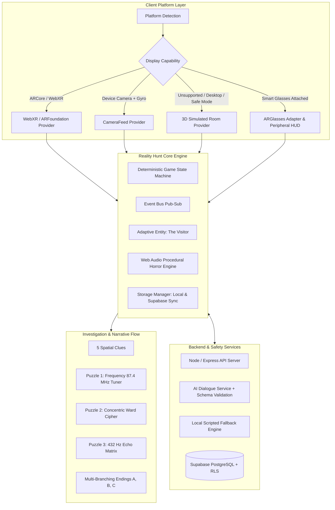
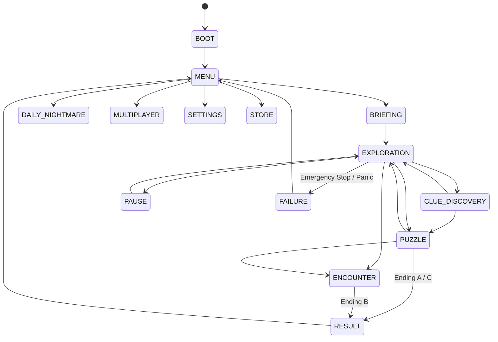

# REALITY HUNT — SYSTEM ARCHITECTURE SPECIFICATION

REALITY HUNT is a production-oriented cross-platform augmented reality psychological horror game and future AR glasses platform. This document outlines the core architectural layers, state transitions, audio synthesis graph, and entity behavior loops.

---

## 1. High-Level Architecture Overview



---

## 2. Deterministic Game State Machine

The client gameplay loop is governed by `GameStateMachine.ts`, enforcing strict unidirectional transitions:



---

## 3. Modular AR & Spatial Fallback Pipeline

To ensure the game is 100% playable anywhere—from an advanced AR headset or mobile phone to a budget desktop without a webcam—the system uses an abstract provider pattern:

1. **`WebXRProvider`**: Implements WebXR `immersive-ar` session with hit-test and plane-detection.
2. **`CameraFeedProvider`**: Captures real video feed via `navigator.mediaDevices.getUserMedia` with device orientation (gyroscope) tracking and WebGL post-processing shaders.
3. **`SimulatedRoomProvider`**: Generates a high-fidelity 3D atmospheric room in Three.js with real-time shadow casting, flickering industrial lighting, furniture, floor runes, and first-person touch/drag navigation.
4. **`GlassesSimulator`**: Renders a lightweight, high-contrast, peripheral-safe waveguide HUD with voice command integration (Web Speech API).

---

## 4. Web Audio Procedural Synthesis Graph

No copyrighted audio files are used. All soundscapes are synthesized directly via the Web Audio API in `HorrorAudioEngine.ts`:

- **Atmospheric Sub-Bass Drone**: 46 Hz sawtooth + 47.8 Hz detuned triangle wave run through a 140 Hz resonant lowpass filter modulated by a 0.15 Hz LFO.
- **Dynamic Heartbeat Pulse**: Dual-stroke "lub-dub" bandpassed sine oscillator at 58 Hz and 48 Hz with exponential decay, dynamically scaling from 60 BPM to 145 BPM based on the player's real-time Fear Index.
- **Geiger Counter Crackle**: Poisson-distributed randomized pulse clicks triggered inversely proportional to anomaly proximity.
- **Dissonant Encounter Stinger**: Cluster chord of minor seconds (185 Hz, 196 Hz, 370 Hz, 392 Hz, 740 Hz) with pitch glide and white-noise static burst.
- **432 Hz Tuning Fork**: Pure acoustic sine harmonic tone with a 2-second resonant decay envelope.

---

## 5. "The Visitor" Adaptive Entity Behavior System

The Visitor is an original, fictional supernatural entity driven by a dynamic state machine and calibrated tension curve:

```
[DORMANT]
   │ (Clue 1 discovered)
   ▼
[STALKING] (Distance: 5–9m, gentle static crackle, Geiger clicks)
   │ (3 clues found OR prolonged direct stare with flashlight)
   ▼
[MANIFESTING] (Distance: 2.5–4m, audible whispers, spatial light distortion)
   │
   ├─► (Puzzle failed OR lingered too long without ward alignment)
   │      │
   │      ▼
   │   [HUNTING] (Distance: 1–2m, heartbeat spike, violent jitter)
   │      │
   │      ▼
   │   (Contact -> Ending B: "Tuned Into The Static")
   │
   └─► (Runic ward rings aligned / Frequency calibrated)
          │
          ▼
       [BANISHED] (Dispersal into light -> Ending A / C)
```

---

## 6. AI Dialogue Engine & Safety Guardrails

- **Persona**: Field Dispatcher 7 from the Bureau of Occult Telemetry.
- **Schema Validation**: Output is validated against Zod schema (`speaker`, `message`, `tensionLevel`, `soundTrigger`, `suggestedAction`).
- **Safety Boundaries**: Regex and token filters strictly block real-world addresses, real phone numbers, real names, claims of real supernatural beings, or dangerous real-world instructions.
- **Scripted Local Fallback**: If network is offline, the API times out (4s budget), or rate-limiting engages, the game switches transparently to local deterministic narrative nodes with zero gameplay interruption.
